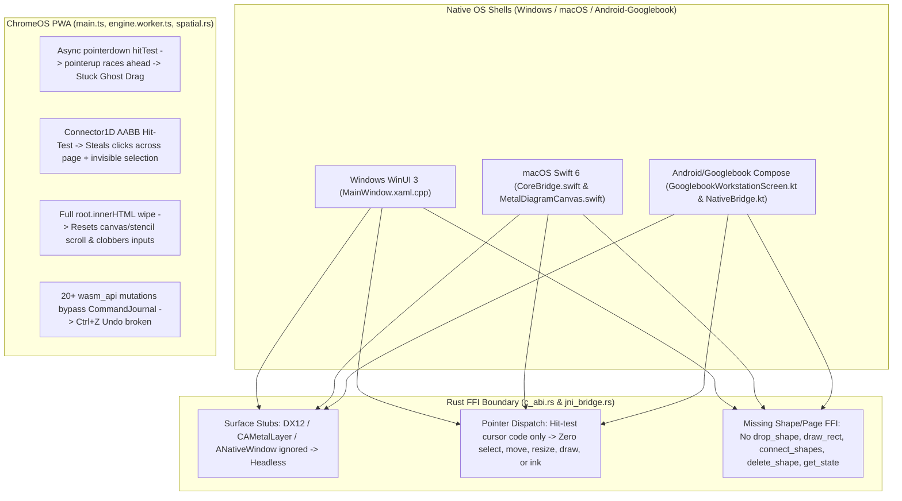

# Multi-Platform Functional Audit Report

> [!IMPORTANT]
> **Executive Verdict:** While the underlying Rust ShapeSheet, `.vsdx`/`.vsd`/`.dwg`/`.dxf` codecs, layout/routing algorithms, and exporters pass unit tests in isolation (`55/55` workspace tests), **none of the four end-user applications currently deliver a working interactive diagramming experience.**
> - **All 3 Native Apps (Windows, macOS, Android/Googlebook OS)** fail to build release binaries in CI, attach **headless no-op stubs** instead of real GPU surfaces (rendering a completely blank/black canvas), ignore pointer drag/draw/select gestures in FFI, and wire multiple toolbar/menu commands to UI-only banners or non-existent shape IDs.
> - **The Live ChromeOS PWA** renders shapes via CPU SVG, but suffers from a critical **`async pointerdown` race condition** (causing broken clicks and stuck ghost-drag rectangles), **1D connector AABB hit-box hijacking** (stealing clicks across the page with zero selection highlight), **full-DOM `innerHTML` wipes** (resetting scroll positions and wiping modal inputs), and **~20 mutations that bypass Undo/Redo**.

---

## 1. End-to-End Failure Architecture Map

---

## 2. Shared Rust Engine & Native FFI Blockers (`crates/*`)

### 2.1 Zero GPU Surface Attachment or Frame Presentation (`Blank Canvas` on All 3 Native Platforms)
- **Windows DX12 & macOS Metal ([c_abi.rs](../../crates/vexio-core/src/ffi/c_abi.rs#L310-L361)):**
  - [`vexio_viewport_create_dx12_swapchain`](../../crates/vexio-core/src/ffi/c_abi.rs#L310-L334) and [`vexio_viewport_create_metal_layer`](../../crates/vexio-core/src/ffi/c_abi.rs#L337-L361) check for non-null pointers and then **discard `dxgi_swapchain_panel_unk` and `ca_metal_layer_ptr`**, delegating directly to [`vexio_viewport_create_headless`](../../crates/vexio-core/src/ffi/c_abi.rs#L288-L307).
  - [`VexioViewport`](../../crates/vexio-core/src/ffi/c_abi.rs#L70-L73) only stores `page_id` and `ViewportCamera`; it holds **no `wgpu::Surface` or `WgpuCanvasRenderer`**, and `vexio.h` / `c_abi.rs` exports **no `vexio_viewport_render_frame` function**. Zero frames are ever presented to `SwapChainPanel` or `CAMetalLayer`.
- **Android / Googlebook Vulkan ([jni_bridge.rs](../../crates/vexio-core/src/ffi/jni_bridge.rs#L101-L123)):**
  - [`Java_com_vexio_core_NativeBridge_nativeAttachVulkanSurface`](../../crates/vexio-core/src/ffi/jni_bridge.rs#L101-L123) names its `Surface` parameter `_surface: JObject` and ignores it completely. [`Cargo.toml`](../../crates/vexio-core/Cargo.toml#L25-L33) only links `wgpu` on `wasm32`, and links no Android `ndk` (`ANativeWindow_fromSurface`) crate. The center `SurfaceView` renders **0 pixels**.

### 2.2 Pointer & Stylus FFI Performs Zero Authoring Actions
- **C-ABI ([`vexio_viewport_dispatch_pointer`](../../crates/vexio-core/src/ffi/c_abi.rs#L372-L402)):** Casts `vp` and `doc` as immutable (`&*vp`, `&*doc`), runs `index.hit_test_point(...)`, and writes a cursor integer (`0`, `1`, or `3`). Clicking or dragging on Windows or macOS **never selects a shape, moves a shape, resizes handles, draws rectangles/connectors/freeform splines, records stylus ink, or pans/zooms `vp.camera`**.
- **JNI ([`Java_com_vexio_core_NativeBridge_nativePushMotionBatch`](../../crates/vexio-core/src/ffi/jni_bridge.rs#L144-L186)):** Skips all coalesced/predicted stylus samples, reads only the final `(x_px, y_px)` with immutable `*const VexioDoc`, and returns Android `PointerIcon` constants `1013` or `1000`. Worse, [`VexioCursorKind.fromNativeCode`](../../apps/android-googlebook/app/src/main/java/com/vexio/core/NativeBridge.kt#L327-L345) expects `0..11`, so `1013` and `1000` both fall back to `ARROW(0)`, breaking even hover and tool cursors.

### 2.3 Missing Core Authoring FFI Surface (`c_abi.rs` & `jni_bridge.rs`)
Neither [`c_abi.rs`](../../crates/vexio-core/src/ffi/c_abi.rs) nor [`jni_bridge.rs`](../../crates/vexio-core/src/ffi/jni_bridge.rs) exposes functions for:
- Dropping a built-in stencil master (`drop_builtin_shape`) or drawing 2D/freeform shapes,
- Connecting two shapes (`connect_shapes`) or adding stylus ink strokes (`add_ink_stroke`),
- Deleting shapes, adding/reordering pages, updating layers, running auto-layout, or running BPMN/UML/SharePoint validation,
- Reading document/page snapshot state (`pages`, `shapes`, `layers`, `validation_issues`) after opening a `.vsdx`/`.vsd`/`.dwg` file.

### 2.4 1D Connector AABB Hit-Test Hijacking ([spatial.rs](../../crates/vexio-render/src/spatial.rs#L35-L43))
- [`SpatialEntry::from_visual`](../../crates/vexio-render/src/spatial.rs#L35-L43) and [`SpatialIndex::hit_test_point`](../../crates/vexio-render/src/spatial.rs#L242-L264) test full **axis-aligned bounding box (AABB)** containment even for `Connector1D` polylines, returning the highest `z_order` match.
- Any L-shaped or diagonal connector spanning across a diagram creates a giant invisible rectangle at high `z_order` that **intercepts clicks meant for shapes or empty canvas** inside its bounding box.

---

## 3. ChromeOS PWA (`apps/chromeos-pwa` — Live on Firebase Hosting)

Confirmed via live headless Chromium CDP interaction testing against `https://vexio-chromeos-suite.web.app` and line-by-line review:

| # | Severity | Area | Exact Root Cause & User-Visible Symptom |
|---|---|---|---|
| C1 | **P0 Blocker** | Canvas Click & Drag ([main.ts](../../apps/chromeos-pwa/src/main.ts#L2449-L2614)) | `pointerdown` awaits `this.callEngine('hitTest', ...)` ([line 2562](../../apps/chromeos-pwa/src/main.ts#L2562)) **before** setting `this.dragState`. On any normal click or quick trackpad tap, `pointerup` ([line 2746](../../apps/chromeos-pwa/src/main.ts#L2746)) fires while `this.dragState` is still `null` and exits early; `pointerdown` then resumes after mouse release and sets `this.dragState = { mode: 'move' \| 'lasso' }` without calling `render()`. Result: clicking shapes fails to update selection handles, clicking empty space fails to deselect, and moving the mouse with **no button pressed** drags a stuck ghost rectangle/lasso across the screen. Missing `pointercancel` / `lostpointercapture` and `ev.buttons === 0` guards make this stickiness permanent until another slow click. |
| C2 | **P0 Blocker** | 1D Connector Selection & Ports ([main.ts](../../apps/chromeos-pwa/src/main.ts#L849-L853), [spatial.rs](../../crates/vexio-render/src/spatial.rs#L242-L264)) | Clicking inside a routed connector's AABB selects the `Connector1D` instead of underlying shapes, yet [`renderSelectionOverlays`](../../apps/chromeos-pwa/src/main.ts#L850-L852) filters `s.kind !== 'Connector1D'`, rendering **zero selection highlight or endpoint handles**. Shapes also render **no connection ports / AutoConnect arrows**, so users cannot drag a connector from a shape port in Pointer mode. |
| C3 | **P0 Blocker** | Deselection Fallback Bug ([main.ts](../../apps/chromeos-pwa/src/main.ts#L911-L913)) | `selectedShape` falls back to `?? snap.shapes[0] ?? null`. Even when `selectedShapeIds` is empty (`Selected: 0`), the Inspector, Formula Strip, and ShapeSheet continue displaying Shape `#1`, while edits in `#shape-text-input` ([line 2907](../../apps/chromeos-pwa/src/main.ts#L2907)) silently abort because `primarySelectedId === null`. |
| C4 | **P1 Critical** | Full DOM Re-Render Side Effects ([main.ts](../../apps/chromeos-pwa/src/main.ts#L964-L1206)) | Every `this.render()` overwrites `root.innerHTML`, resetting `.stencil-pane`, `.canvas-viewport`, `.inspector-pane`, and `.shapesheet-dock` scroll positions back to `(0, 0)` on every click/drop, and wiping unsaved text in modal editors if a background render fires. |
| C5 | **P1 Critical** | Inline Text Editing Missing ([main.ts](../../apps/chromeos-pwa/src/main.ts#L2435-L2447)) | `dblclick` on `#diagram-host` only navigates if `sh.subprocessPage` is set. Double-clicking any shape (or pressing `F2`) does **nothing** instead of opening an inline canvas text editor. |
| C6 | **P1 Critical** | Pan, Wheel Zoom, Fit & Scroll Clipping ([m3-expressive.css](../../apps/chromeos-pwa/src/styles/m3-expressive.css#L736-L743), [main.ts](../../apps/chromeos-pwa/src/main.ts#L2035-L2050)) | No `Ctrl+Wheel` / pinch zoom handler; no `Space+Drag`, middle-mouse pan, or Pan tool (and `touch-action: none` blocks touch scrolling on the page); `Fit` button ([line 2040](../../apps/chromeos-pwa/src/main.ts#L2040)) hardcodes `zoomPct = 100` instead of fitting the viewport; Flexbox `align-items/justify-content: center` on `.canvas-viewport` clips top/left scroll regions when zoomed in; `.floating-zoom-bar` and `.minimap-dock` sit inside the scrolling `.canvas-viewport` instead of `.canvas-shell` (and minimap has zero click/drag listeners); rulers don't track scroll or sheet centering. |
| C7 | **P1 Critical** | Undo/Redo Bypassed by 20+ Commands ([wasm_api.rs](../../crates/vexio-core/src/ffi/wasm_api.rs#L981-L1715)) | Boolean ops, themes, visual presets, containers, swimlanes, callouts, rooms, freeform curves, vertex/control-handle drags, auto-layout, subprocesses, hyperlinks, title blocks, org charts, Gantt/PERT/Timeline, SQL ERD, and CSV Data Graphics mutate `self.inner.doc` directly without `CommandJournal` entries — `Ctrl+Z` cannot undo any of them. |
| C8 | **P1 Critical** | File Save Clobber & CAD Import ([main.ts](../../apps/chromeos-pwa/src/main.ts#L539-L569)) | Opening a `.dwg` or `.vsd` sets `this.activeFileHandle` to that file; pressing `Ctrl+S` (`handleSaveInPlace('vsdx')`) **overwrites the `.dwg`/`.vsd` file in place with `.vsdx` bytes**. `#btn-ins-cad` calls `handleOpenDisk()`, wiping the current document instead of importing CAD layers onto the active page, and dropping OS files onto the canvas is ignored. |
| C9 | **P1 Critical** | Service Worker Stale HTML & Auth Popup ([sw.js](../../apps/chromeos-pwa/public/sw.js#L80-L97), [firebaseClient.ts](../../apps/chromeos-pwa/src/firebase/firebaseClient.ts#L166-L184)) | `sw.js` serves stale cached `/index.html` on reload (Stale-While-Revalidate instead of Network-First for `navigate`), and `Sign In` ([line 1681](../../apps/chromeos-pwa/src/main.ts#L1681)) has no `try/catch` UI feedback and uses `signInWithPopup` under `Cross-Origin-Opener-Policy: same-origin` (which severs `window.opener`). |
| C10 | **P2 Major** | ShapeSheet & Keyboard Polish ([main.ts](../../apps/chromeos-pwa/src/main.ts#L476-L518)) | ShapeSheet table rows (`.ss-table`) aren't clickable; formula bar cell selector is hardcoded to 10 cell names, lacks `Enter` key commit, and silently drops rejected `GUARD()` edits without a warning toast; `Ctrl+Z` hijacks text inputs; `Ctrl+O`, `Ctrl+C/V/D`, `Escape`, and Arrow-key nudges are missing; multi-tab OPFS keeps `FileSystemSyncAccessHandle` locked indefinitely ([opfs-journal.worker.ts](../../apps/chromeos-pwa/src/workers/opfs-journal.worker.ts#L68-L86)). |

---

## 4. Windows Native Shell (`apps/windows` — WinUI 3 / C++20 / DirectX 12)

1. **CI Release Build Broken ([release-windows.yml](../../.github/workflows/release-windows.yml)):**
   - GitHub Actions run `44881974939` failed at CMake configure: `Generator Visual Studio 17 2022 could not find any instance of Visual Studio` because `windows-latest` migrated to `windows-2025` (VS 2026).
2. **Completely Blank DirectX 12 Canvas ([MainWindow.xaml.cpp](../../apps/windows/src/MainWindow.xaml.cpp#L158-L209)):**
   - [`AttachOrResizeDx12SwapChain`](../../apps/windows/src/MainWindow.xaml.cpp#L158-L209) passes `ISwapChainPanelNative*` to `vexio_viewport_create_dx12_swapchain`, which delegates to the headless stub and never binds a DXGI swapchain (`SetSwapChain`) or renders frames.
3. **All Shape Seeding & Stencil Drops Fail Silently ([MainWindow.xaml.cpp](../../apps/windows/src/MainWindow.xaml.cpp#L651-L716)):**
   - `DocHandle::CreateBlank` creates a document with **0 shapes**. Both [`SeedActiveShapeDefaultCells`](../../apps/windows/src/MainWindow.xaml.cpp#L695-L716) (`shape_id = 1`) and [`InstantiateMasterOnCanvas`](../../apps/windows/src/MainWindow.xaml.cpp#L651-L690) (`newShapeId = m_nextShapeId++`) call `m_doc.SetCellFormula` on shape IDs that **do not exist in `m_doc`**, discarding the `VEXIO_ERR_INVALID_ARG` return value via `(void)`. Even the CPU `WriteableBitmap` minimap ([`OnRefreshPanZoomPreviewClick`](../../apps/windows/src/MainWindow.xaml.cpp#L1168-L1194)) renders a blank white box because `m_doc` has 0 shapes.
4. **Multiple Ribbon Commands Are Pure UI Banner Stubs ([MainWindow.xaml.cpp](../../apps/windows/src/MainWindow.xaml.cpp#L1477-L2026)):**
   - **Auto-Layout (`Top-Down`, `Left-Right`, `Radial`):** [Lines 1695–1711](../../apps/windows/src/MainWindow.xaml.cpp#L1695-L1711) only call `ShowBanner(InfoBarSeverity::Success, ...)` without touching `m_doc`.
   - **Diagram Validation (`Check Diagram`):** [Lines 1788–1797](../../apps/windows/src/MainWindow.xaml.cpp#L1788-L1797) hardcode `"✓ 0 Validation Issues"` without calling `vexio-core` validators.
   - **Distribute / Copy / Cut / Convert CAD / Convert Ink / Starter Templates:** [`OnDistributeHorizontallyClick`](../../apps/windows/src/MainWindow.xaml.cpp#L1524-L1527), [`OnConvertCadToShapeSheetClick`](../../apps/windows/src/MainWindow.xaml.cpp#L1568-L1572), and [`OnConvertInkToShapesClick`](../../apps/windows/src/MainWindow.xaml.cpp#L1860-L1864) only display banners; [`OnCopyShapeClick`](../../apps/windows/src/MainWindow.xaml.cpp#L1477-L1481) hardcodes `"flow.process"`; starter template buttons ([lines 2004–2026](../../apps/windows/src/MainWindow.xaml.cpp#L2004-L2026)) open an empty document.
   - **Pages, Layers & External Data ([lines 1031–1080, 1263–1301](../../apps/windows/src/MainWindow.xaml.cpp#L1263-L1301)):** Mutate C++-only vectors (`m_pages`, `m_layers`, `m_externalRecords`) without updating Rust `m_doc`.
5. **Light Mode Caption Button Contrast Bug ([line 149](../../apps/windows/src/MainWindow.xaml.cpp#L149)):**
   - `titleBar.ButtonForegroundColor(Colors::White())` renders white Minimize/Maximize/Close glyphs on the Light Mode titlebar.

---

## 5. macOS Native Shell (`apps/macos` — Swift 6 / AppKit + SwiftUI / Metal)

1. **CI Release Build Broken ([Package.swift](../../apps/macos/Package.swift), [release-macos.yml](../../.github/workflows/release-macos.yml)):**
   - GitHub Actions run `44881974956` failed in `xcodebuild` due to `swiftLanguageModes: [.v6]` format incompatibility (`given: [6], supported: [4.0, 4.2, 5.0, 6.0]`).
2. **Completely Blank `CAMetalLayer` Canvas ([MetalDiagramCanvas.swift](../../apps/macos/Sources/VexioMacApp/MetalDiagramCanvas.swift#L151-L179)):**
   - [`VexioMetalNSView.syncViewportDrawableIfNeeded`](../../apps/macos/Sources/VexioMacApp/MetalDiagramCanvas.swift#L151-L179) passes `CAMetalLayer` into `vexio_viewport_create_metal_layer`, which delegates to the headless stub. Zero Metal command buffers or drawables are ever presented; only clicking the separate `eye` toolbar icon ([`generateAndShowOffscreenPreview`](../../apps/macos/Sources/VexioMacApp/VexioWorkspaceView.swift#L470-L479)) opens a static modal `CGImage`.
3. **CRDT Shape-Creation Workaround Produces Geometryless Shapes ([CoreBridge.swift](../../apps/macos/Sources/VexioMacApp/CoreBridge.swift#L1324-L1349)):**
   - Because C-ABI lacks `drop_shape`, [`upsertShapeInCore`](../../apps/macos/Sources/VexioMacApp/CoreBridge.swift#L1324-L1349) injects a synthetic `"UpsertShape"` CRDT op and sets `PinX`/`Width`/`Height` cells — leaving **zero `Geometry1` path rows** on created shapes.
4. **Canvas Input, Pan/Zoom, Auto-Layout & Validation Disconnected from Rust:**
   - Mouse/trackpad events ([`MetalDiagramCanvas.swift`](../../apps/macos/Sources/VexioMacApp/MetalDiagramCanvas.swift#L268-L374)) update Swift-only `session.zoomScale` / `session.panOffset` (never synced to `VexioViewport.camera`) and call cursor-only `vexio_viewport_dispatch_pointer`.
   - [`applyAutoLayout`](../../apps/macos/Sources/VexioMacApp/CoreBridge.swift#L1618-L1633) merely sets `PinY = "5.50 in"` on the single selected shape instead of running graph layout.
   - [`runDiagramValidation`](../../apps/macos/Sources/VexioMacApp/CoreBridge.swift#L1635-L1684) only checks `widthExpr.hasPrefix("0")` and `routeStyle == "0"` in Swift rather than invoking `vexio-core`'s BPMN 2.0 / UML 2.5 / SharePoint validators.
   - Plan 2 menu items (`Import Data Visualizer`, `Import Cloud Discovery`, `Import Entra/LDIF`) only load hardcoded sample strings when invoked from the menu bar ([`VexioMacApp.swift`](../../apps/macos/Sources/VexioMacApp/VexioMacApp.swift#L326-L341)).

---

## 6. Android & Googlebook OS Native Shell (`apps/android-googlebook` — Kotlin / Compose M3E / Vulkan)

1. **Does Not Compile (`4` Kotlin Compiler Errors in [GooglebookWorkstationScreen.kt](../../apps/android-googlebook/app/src/main/java/com/vexio/ui/workstation/GooglebookWorkstationScreen.kt)):**
   - [Line 555](../../apps/android-googlebook/app/src/main/java/com/vexio/ui/workstation/GooglebookWorkstationScreen.kt#L555): Unqualified `AnimatedVisibility(...)` inside `Box` resolves to outer `ColumnScope.AnimatedVisibility` and fails compilation.
   - [Lines 1359–1377](../../apps/android-googlebook/app/src/main/java/com/vexio/ui/workstation/GooglebookWorkstationScreen.kt#L1359-L1377): `Modifier.dragAndDropSource { detectTapGestures(...) { startTransfer(...) } }` uses removed pre-1.8 Compose drag-and-drop APIs under `compose-bom:2025.05.00`.
   - `app/build.gradle.kts` also lacks a release `signingConfig`, producing an un-installable `app-release-unsigned.apk`.
2. **Unrendered Black `SurfaceView` & Disconnected Motion Batching ([NativeBridge.kt](../../apps/android-googlebook/app/src/main/java/com/vexio/core/NativeBridge.kt#L851-L1059)):**
   - `SurfaceView` attaches to the no-op JNI stub; zero frames are ever drawn, `uiState.activeTool` is never sent to Rust, and `nativePushMotionBatch` neither selects, moves, draws, connects, inks, nor pans.
3. **Fake Kotlin State Mirrors & Silent JNI Failures ([NativeBridge.kt](../../apps/android-googlebook/app/src/main/java/com/vexio/core/NativeBridge.kt#L1310-L1543)):**
   - Startup `WorkstationUiState` ([lines 668–680](../../apps/android-googlebook/app/src/main/java/com/vexio/core/NativeBridge.kt#L668-L680)) fabricates 3 pages and `Sheet.1 (Gateway Node)` while Rust `docPtr` is completely empty (`0` shapes). Editing the Formula Bar at startup fails with `ShapeNotFound`, which JNI maps to code `2` (`SYNTAX_ERROR`).
   - [`instantiateMasterDrop`](../../apps/android-googlebook/app/src/main/java/com/vexio/core/NativeBridge.kt#L1311-L1362) increments a Kotlin-only counter (`nextSyntheticShapeId++`) and calls `nativeSetCellFormula` on a non-existent shape ID — pretending in the UI that a shape was dropped while Rust `VisioDocument` remains empty.
   - [`deleteSelectedShape`](../../apps/android-googlebook/app/src/main/java/com/vexio/core/NativeBridge.kt#L1443-L1454) and [`addNewPage`](../../apps/android-googlebook/app/src/main/java/com/vexio/core/NativeBridge.kt#L1114-L1129) never call JNI at all; [`exportPlan2Artifact`](../../apps/android-googlebook/app/src/main/java/com/vexio/core/NativeBridge.kt#L2301-L2311) serializes bytes and discards them without saving; [`openDocumentFromBytes`](../../apps/android-googlebook/app/src/main/java/com/vexio/core/NativeBridge.kt#L2329-L2371) never refreshes pages or shapes into `_uiState`.
4. **Adaptive Pane Toggle Dead Zones ([GooglebookWorkstationScreen.kt](../../apps/android-googlebook/app/src/main/java/com/vexio/ui/workstation/GooglebookWorkstationScreen.kt#L479-L610)):**
   - Clicking the Inspector header button does nothing on windows `< 1180.dp` (`posture == ULTRAWIDE_DESKTOP` gate at [line 608](../../apps/android-googlebook/app/src/main/java/com/vexio/ui/workstation/GooglebookWorkstationScreen.kt#L608)), and clicking the Stencil toggle does nothing on `< 760.dp` ([line 480](../../apps/android-googlebook/app/src/main/java/com/vexio/ui/workstation/GooglebookWorkstationScreen.kt#L480)).

---

## 7. Remediation Blueprint (Ready to Execute)

1. **Unify Full Interactive Authoring & Rendering Across `c_abi.rs` & `jni_bridge.rs`:**
   - Wire real `wgpu` surface creation (`SurfaceTargetUnsafe::SwapChainPanel` on Windows DX12, `SurfaceTargetUnsafe::CoreAnimationLayer` on macOS Metal, `ANativeWindow_fromSurface` on Android Vulkan) into `VexioViewport` + `vexio_viewport_render_frame` (with deterministic pixel-buffer presenter fallback if headless/WARP).
   - Expose full `DocumentSession` authoring & state APIs (`drop_builtin_shape`, `draw_rect`, `draw_freeform`, `connect_shapes`, `add_ink_stroke`, `transform_shape`, `delete_shapes`, `add_page`, `auto_layout`, `validate_diagram`, `get_state_json`) and stateful pointer/tool state machine inside `VexioViewport` so Windows, macOS, and Android share 1:1 canvas interaction with Rust.
   - Fix [`SpatialIndex::hit_test_point`](../../crates/vexio-render/src/spatial.rs#L242-L264) to compute true point-to-segment polyline distance for `Connector1D` shapes.
2. **Make ChromeOS PWA (`apps/chromeos-pwa`) 100% Interactive & Rock-Solid:**
   - Make canvas hit-testing synchronous/race-free on pointerdown + add `ev.buttons` / `pointercancel` guards so ghost-dragging can never occur.
   - Add inline double-click/`F2` shape text editing, visible 1D connector selection + draggable endpoints + hover connection ports, `Ctrl+Wheel`/pinch focal zoom (`10%–1600%`), real `Fit` calculation, `Space`/Middle-click/Touch pan, scroll-preserving DOM updates, `CommandJournal` wrapping for all 20+ commands, safe `Save As` `.vsdx` when a `.dwg`/`.vsd` is open, Network-First `sw.js` navigation, and `COOP: same-origin-allow-popups` / clean Firebase Auth handling.
3. **Fix All 3 Native Shells & Green All 4 GitHub Actions Release Pipelines:**
   - Fix `release-windows.yml` CMake VS generator + replace all C++ banner stubs and non-existent `shape_id` calls in [`MainWindow.xaml.cpp`](../../apps/windows/src/MainWindow.xaml.cpp).
   - Fix `apps/macos/Package.swift` under `xcodebuild` + wire real Metal rendering, stencil creation, layout, and validation in [`CoreBridge.swift`](../../apps/macos/Sources/VexioMacApp/CoreBridge.swift).
   - Fix all 4 Kotlin compiler errors + signing config + real Vulkan surface/JNI state sync in [`GooglebookWorkstationScreen.kt`](../../apps/android-googlebook/app/src/main/java/com/vexio/ui/workstation/GooglebookWorkstationScreen.kt) and [`NativeBridge.kt`](../../apps/android-googlebook/app/src/main/java/com/vexio/core/NativeBridge.kt).
