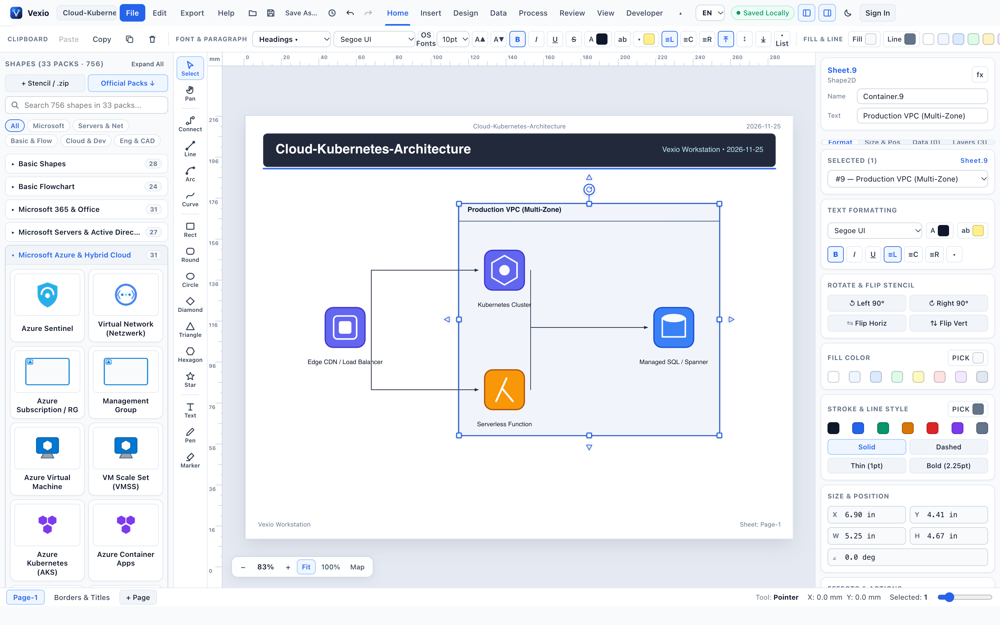
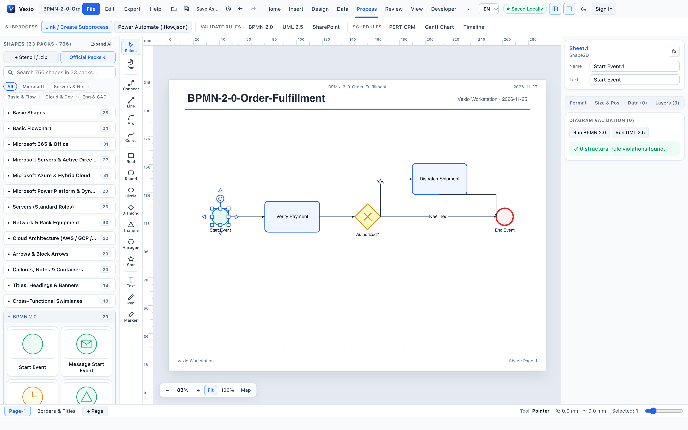
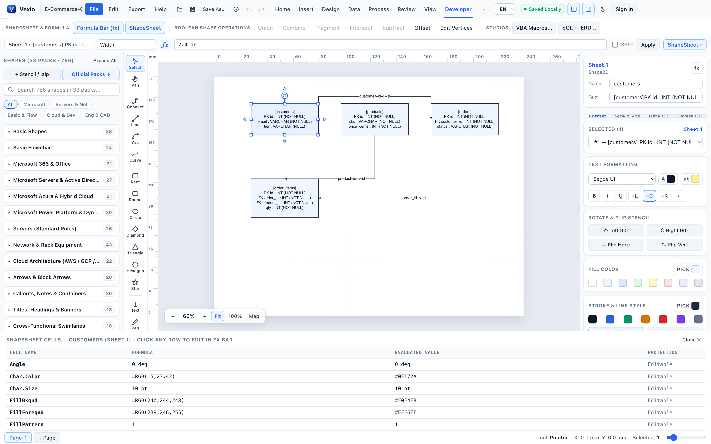
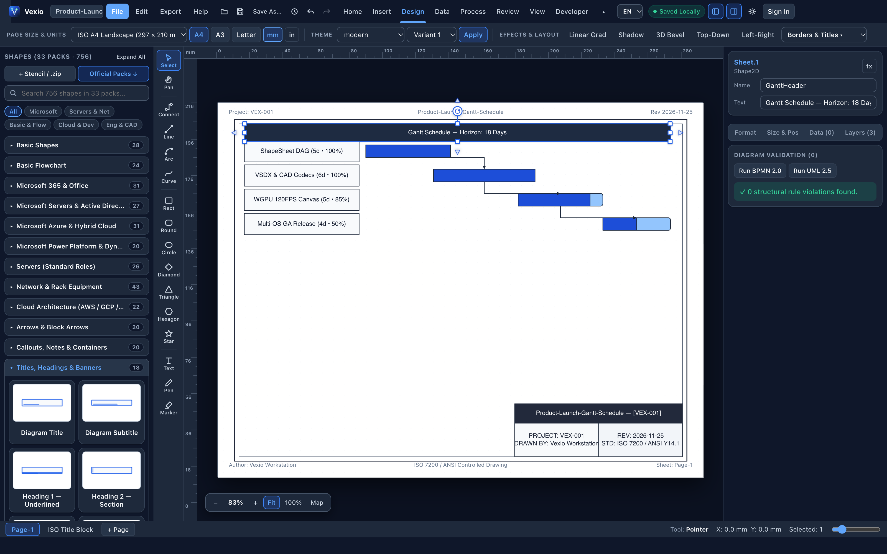
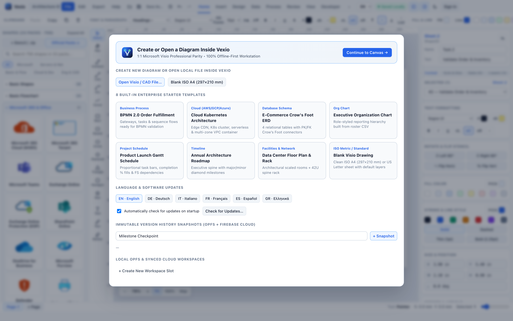
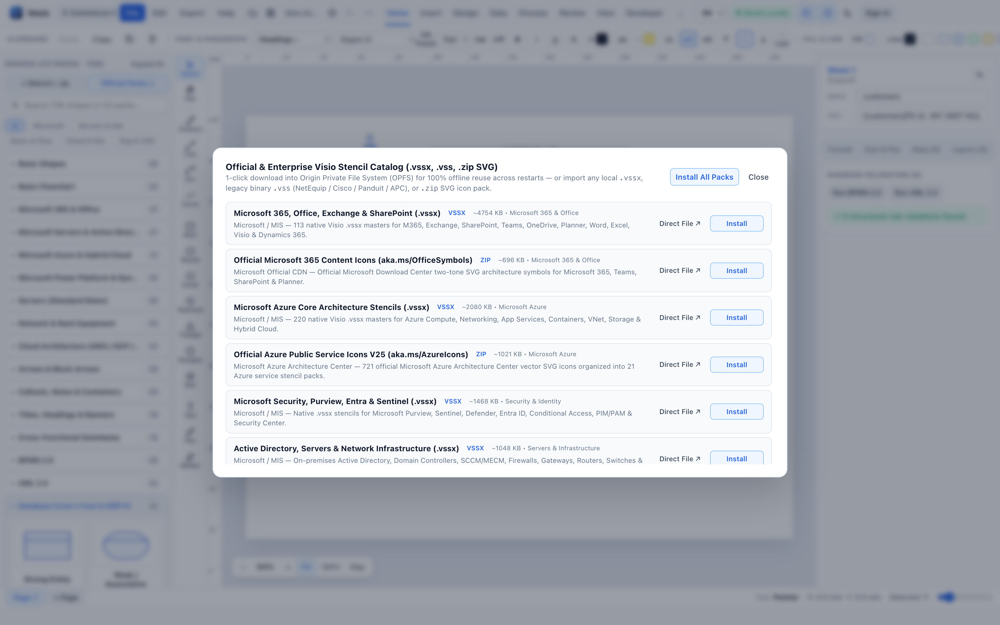

# Vexio

<p align="center">
  <strong>Enterprise-Grade 1:1 Microsoft Visio Professional / Plan 2 Functional Parity Suite</strong><br/>
  Deterministic Rust ShapeSheet &amp; CAD Engine • Native WinUI 3 (DX12) • Native macOS Swift 6 Liquid Glass (Metal) • Native Android &amp; Googlebook OS Compose M3E (Vulkan) • 100% Offline-First ChromeOS Workstation PWA (WASM SIMD + WebGPU)
</p>

<p align="center">
  <a href="https://github.com/petrosvassiliou/vexio/releases/tag/v0.4.3-alpha"></a>
  <a href="https://github.com/petrosvassiliou/vexio/actions"></a>
  <a href="https://vexio-chromeos-suite.web.app"></a>
  
</p>



**Vexio** is a full-featured, **1:1 Microsoft Visio Professional / Plan 2** diagramming, CAD interop, process engineering, and reactive data-visualization workstation suite.

Every file codec, reactive ShapeSheet formula, A\* connector router, AutoCAD `.dwg`/`.dxf` translator, structural validator, and GPU tessellation pass executes inside a **single, deterministic, zero-UI-dependency Rust workspace (`crates/*`)**, delivered through **strictly zero-wrapper native OS workstation shells** (`apps/windows`, `apps/macos`, `apps/android-googlebook`) and a **Firebase-powered, 100% unauthenticated offline-first ChromeOS PWA** (`apps/chromeos-pwa` + `firebase/`).

---

## Download Installers (`v0.4.3-alpha`)

All compiled native installers and offline bundles are published on the [**`v0.4.3-alpha` Releases Page**](https://github.com/petrosvassiliou/vexio/releases/tag/v0.4.3-alpha):

| Platform | Architecture & Graphics Stack | Direct Installer Download |
| :--- | :--- | :--- |
| **Windows 11 Native** | `x64` (`WinUI 3` + `DirectX 12`) | [**`Vexio-Windows-v0.4.3-alpha-x64.msix`**](https://github.com/petrosvassiliou/vexio/releases/download/v0.4.3-alpha/Vexio-Windows-v0.4.3-alpha-x64.msix) |
| **Windows 11 Native** | `ARM64` (`WinUI 3` + `DirectX 12`) | [**`Vexio-Windows-v0.4.3-alpha-arm64.msix`**](https://github.com/petrosvassiliou/vexio/releases/download/v0.4.3-alpha/Vexio-Windows-v0.4.3-alpha-arm64.msix) |
| **macOS 15+ Native** | `Universal2` Apple Silicon + Intel (`Swift 6 Liquid Glass` + `Metal` + `Quick Look`) | [**`Vexio-v0.4.3-alpha-Universal2.dmg`**](https://github.com/petrosvassiliou/vexio/releases/download/v0.4.3-alpha/Vexio-v0.4.3-alpha-Universal2.dmg) |
| **Android & Googlebook OS** | `arm64-v8a` + `x86_64` APK (`Jetpack Compose M3E` + `Vulkan`) | [**`Vexio-Android-Googlebook-v0.4.3-alpha.apk`**](https://github.com/petrosvassiliou/vexio/releases/download/v0.4.3-alpha/Vexio-Android-Googlebook-v0.4.3-alpha.apk) |
| **Android & Googlebook OS** | `arm64-v8a` + `x86_64` Play App Bundle (`AAB`) | [**`Vexio-Android-Googlebook-v0.4.3-alpha.aab`**](https://github.com/petrosvassiliou/vexio/releases/download/v0.4.3-alpha/Vexio-Android-Googlebook-v0.4.3-alpha.aab) |
| **ChromeOS Offline-First PWA** | Live Hosted App + Offline Bundle (`WASM SIMD` + `WebGPU` + `OPFS WAL`) | [**Launch Live App**](https://vexio-chromeos-suite.web.app) · [**`Vexio-ChromeOS-PWA-v0.4.3-alpha.zip`**](https://github.com/petrosvassiliou/vexio/releases/download/v0.4.3-alpha/Vexio-ChromeOS-PWA-v0.4.3-alpha.zip) |

---

## High-Resolution Workstation Gallery (`3200×2000` Retina)

| BPMN 2.0 Process Engineering & Live Rule Validation | Docked ShapeSheet Formula Studio & Crow's Foot ERD |
| :---: | :---: |
|  |  |
| **Process Ribbon & Structural Validators:** Cross-functional BPMN 2.0 gateways, Executive Title & Accent Rule, subprocess linking, Power Automate export, and real-time **BPMN 2.0 / UML 2.5 / SharePoint** validation diagnostics. | **Interactive ShapeSheet & Developer Studio:** Live `fx` Formula Bar, docked ShapeSheet inspector (`PinX`, `PinY`, `Width`, `Height`, `GUARD(...)`), 2D Boolean geometry operations, VBA macro studio, and SQL DDL ⇄ ERD engineering. |

| Dark Mode Workstation & ISO 7200 Engineering Title Block | Streamlined Startup & Enterprise Templates Hub |
| :---: | :---: |
|  |  |
| **Dark Mode, Borders & Titles & Schedules:** `ISO 7200 / ANSI Y14.1` Engineering Title Block with metadata cells, `Titles, Headings & Banners` stencil library, PERT/CPM & Gantt schedule generation, and adaptive dark/light themes. | **Focused Startup Experience:** Direct `.vsdx`/`.vsd`/`.vdx`/`.dwg`/`.dxf` local disk open, 8 instant enterprise starter templates, 6-language switcher (`EN`, `DE`, `IT`, `FR`, `ES`, `GR`), and crash-safe local version snapshots. |

<p align="center">
  
  <br/>
  <em><strong>In-App Official &amp; Enterprise Stencil Catalog:</strong> One-click import of official Microsoft 365, Azure Core, Azure Public Service Icons (721 SVGs), Defender/Purview/Entra Security, and Active Directory / Hybrid Network packs alongside local <code>.vssx</code> / <code>.vss</code> / <code>.zip</code> multi-pack imports.</em>
</p>

---

## Complete Feature Matrix (`v0.4.3-alpha`)

### 1. Lossless Visio, Legacy Binary & Offline AutoCAD Interop
- **OpenXML Visio Packages (`vexio-vsdx`):** Lossless read/write for `.vsdx`, `.vssx`, `.vstx`, `.vsdm`, `.vssm`, and `.vstm`. Preserves unrecognized XML elements, custom OPC relationships, embedded raster/vector media, document metadata, themes/variants, master stencils, background pages, headers/footers, and `vbaProject.bin` streams across load → edit → save cycles.
- **Legacy Visio Binary & XML Formats (`vexio-vsd-legacy`):** Native OLE2 Compound File Binary reader/writer for legacy `.vsd`, `.vss`, and `.vst` (`Visio v5`–`v11`) plus DatadiagramML XML (`.vdx`), Visio Web Drawing (`.vdw`), and `.emf` / `.wmf` vector metafile import.
- **100% Offline AutoCAD `.dwg` & `.dxf` Engine (`vexio-cad`):** Native offline parser for `.dwg` (`AC1015` through `AC1032` R2018/R2024 Reed-Solomon + LZ77 decompression) and `.dxf`, plus vector-accurate `.dxf` export with CAD layer visibility/lock/color mapping, architectural scale locking, and lossless CAD-to-ShapeSheet geometry conversion.

### 2. 1:1 Reactive ShapeSheet Formula Engine (`vexio-shapesheet`)
- **220+ Built-In ShapeSheet Functions:** Geometry, trigonometry, logical branching, string manipulation, lookup, coordinate transforms (`PAR`, `PNT`, `LOCTOPAR`, `PARTOLOC`, `INTERSECTX`, `INTERSECTY`, `GRAVITY`), cell indirection (`EVALCELL`, `SETF`, `SETATREF`, `SETATREFEXPR`, `DEPENDSON`), and date/time arithmetic.
- **Canonical Visio Unit System:** Internal precision in canonical Visio units (`inches` for length, `radians` for angles, `days` for elapsed/datetime) with lossless user display units (`mm`, `cm`, `m`, `in`, `ft`, `pt`, `pica`, `deg`, `rad`, `%`) and automatic OS locale Metric (`mm`) / US Imperial (`in`) detection.
- **`GUARD(expr)` & Cross-Page Topological DAG:** Enforces Visio `GUARD` write protection against interactive canvas drags while permitting `SETF` / explicit ShapeSheet formula overrides. Supports cross-shape and cross-page references (`Sheet.N!Cell`, `Pages[PageName]!Sheet.N!Cell`, `TheDoc!Cell`, `ThePage!Cell`) with incremental dirty-subgraph invalidation and deterministic Visio error tokens (`#DIV/0!`, `#VALUE!`, `#NAME?`, `#REF!`).

### 3. Visio Authoring, Typography, Headings & Page Design
- **16 Precision Authoring & Markup Tools:** Pointer & marquee select, hand pan, dynamic connector, straight line, circular/elliptical arc, freeform Bézier/spline curve, rectangle, rounded rectangle, ellipse/circle, decision diamond, triangle, hexagon, 5-point star, rich text box, pressure-sensitive pen ink, and highlighter.
- **Visio Text Headings, Titles & Typography:**
  - **8 Built-In Visio Text Styles (`Home -> Headings` & `Insert -> Title / Heading`):** `Title` (`24 pt` bold), `Subtitle` (`14 pt`), `Heading 1` (`18 pt` bold with bottom rule), `Heading 2` (`15 pt` bold), `Heading 3` (`12.5 pt` uppercase accent), `Section Header Banner` (filled pill banner), `Accent Callout Header` (tinted left-accent callout), `Body`, and `Caption`.
  - **Page Borders & Title Blocks (`Design -> Borders & Titles`):** Dedicated non-interfering `Background Page` (`Page-BG`) hosting `Modern Header Banner`, `Executive Title & Accent Rule`, `Classic Architectural Frame`, `Rounded Pill Banner`, and `ISO 7200 / ANSI Y14.1 Engineering Title Block` (with `Author`, `Date`, `Scale`, `Rev`, and `Sheet` metadata cells), synced dynamically to document title, theme palette, and page size.
  - **Native OS Typography & Styling:** System font enumeration, multi-run rich text formatting, theme palettes (`6 themes × 4 variants`: `Modern`, `Professional`, `Vibrant`, `Blueprint`, `Monochrome`, `Hand-Drawn`), linear/radial gradients, hatch patterns, soft drop shadows, 3D bevels, and sketchy hand-drawn strokes.
- **Advanced Geometry, Grouping & Viewport Ergonomics:**
  - **2D Boolean Shape Operations:** `Union`, `Combine`, `Fragment`, `Intersect`, `Subtract`, `Trim`, `Join`, and `Offset` plus interactive vertex/control-point editing.
  - **Visio Group / Ungroup & Containers:** Parent-relative formula baking (`Ctrl+G` / `Ctrl+Shift+G`), click-through container hit-testing, collapsible Cross-Functional Swimlanes, Lists, and live Smart Alignment & Equal-Spacing Guides.
  - **Continuous Auto-Fit Page Mode & Unsaved-Changes Protection (`v0.4.3-alpha`):** Canvas automatically scales and centers the page dynamically across window/pane resizes until manual zoom, and tracks document `stateRevision` across edits/opens/saves to present native localized **Save / Don't Save / Cancel** confirmation dialogs before quitting or closing modified diagrams on every platform.

### 4. 33 Built-In Vector Stencil Libraries (756+ Masters) & Official Catalog
Every installation ships **100% offline** with **33 deterministic OpenXML `.vssx` domain stencil libraries (756+ multi-color vector masters)** inspired by standard enterprise Visio libraries and community collections (`awesome-visio`), plus an in-app **Official Stencil Catalog** and custom `.vssx` / `.vss` / `.zip` multi-pack importer:

| Domain Category | Built-In `.vssx` Stencil Packs Included Offline |
| :--- | :--- |
| **Core & Typography** | `Basic Shapes` · `Basic Flowchart` · `Arrows & Block Arrows` · `Callouts, Notes & Containers` · `Cross-Functional Swimlanes` · `Titles, Headings & Banners` |
| **Microsoft Cloud & Enterprise** | `Microsoft 365 & Office` · `Microsoft Azure & Hybrid Cloud` · `Microsoft Servers & Active Directory` · `Microsoft Power Platform & Dynamics 365` |
| **Multi-Cloud, Virtualization & Security** | `Cloud Architecture (AWS, GCP & Azure)` · `Multi-Cloud, Kubernetes & VMware (AWS, GCP, OCI, K8s, vSphere)` · `Security & Carrier Vendors (Palo Alto, Fortinet, Check Point, Juniper, Huawei)` · `IT Generic & Security Scanning (Ecceman, MTMnet, OpenVAS)` |
| **Data Center, Rack, NAS & Unified Comms** | `Servers & Standard Roles` · `Network & Rack Equipment` · `Rack Power, Cabling & KVM (CyberPower, Tripp Lite, Raritan, Black Box, HellermannTyton)` · `Enterprise NAS, SMB Network & Unified Comms (Synology, QNAP, TP-Link, Poly, Avaya)` |
| **Process, Decision & Enterprise Architecture** | `BPMN 2.0` · `Decision, Case & Risk Modeling (CMMN 1.1, DMN 1.3 & CORAS)` · `UML 2.5` · `C4 Architecture & Enterprise Integration Patterns (EIP)` · `Systems Engineering & Ontology (SysML, IDEF0, IDEF3, IDEF5)` |
| **Data Engineering, BI & Schedules** | `Database Crow's Foot & IDEF1X` · `Data Vault 2.0, ADAPT & OLAP BI` · `Organization Chart` · `Project Schedule (Gantt & Timeline)` · `Value Stream Mapping (Lean VSM)` |
| **AEC, Electrical, P&ID, IoT & UX** | `Floor Plan & Architecture` (live area calculation) · `Electrical & Electronic (IEEE / IEC)` · `P&ID Process Engineering` · `Smart Home, IoT, Digital Logic & GDS IA/UX` · `UI & Application Wireframes` |

### 5. Visio Plan 2 Enterprise Intelligence, Routing, Validation & Exports
- **Dynamic Connector Routing & Walking Glue:** A\* orthogonal, curved, and straight routing with real-time obstacle avoidance, configurable horizontal/vertical line jumps (`Arc`, `Gap`, `Square`, `2-Sides`), static port-to-port glue, shape-to-shape dynamic walking glue, and outward **AutoConnect** quick-shape triangles.
- **Structural Diagram Validation:** Built-in rule engines for **BPMN 2.0**, **UML 2.5**, and **SharePoint / Workflow** returning structured `ValidationIssue` diagnostics with one-click canvas focus.
- **Two-Way Data Linking, Data Visualizer & Live Data Graphics:**
  - Bidirectional binding to `.xlsx`, `.csv`, `.sqlite`/`.db`, and `.json` sources with **Two-Way Writeback** from `Prop.*` ShapeSheet edits back to external files.
  - **Excel Data Visualizer** round-trip flowchart/swimlane generation, **Icon Sets**, **Data Bars**, **Text Callouts**, **Color-by-Value** rules, auto-generated page **Legends**, and `.xlsx` **Bill of Materials (BOM)** shape inventory reports.
- **Enterprise Generators, Diffing & Automation:**
  - **SQL DDL ⇄ Crow's Foot ERD** reverse & forward schema engineering (`PostgreSQL`, `MySQL`, `SQL Server`, `SQLite`).
  - **Cloud Discovery** (`AWS`, `Azure`, `GCP` JSON topology import), **Org Chart Wizard** (`CSV` / Entra ID / `.ldif`), and **PERT/CPM, Gantt & Timeline** schedule generators.
  - **Visual Diagram Compare** (`.vsdx` revision diff overlay highlighting added, modified, and deleted shapes), multi-target hyperlinks, subprocess page drill-down, and sandboxed **VBA-compatible Automation scripting & UserForms**.
  - **Real-Time HLC CRDT Co-Authoring & Crash-Proof WAL:** Deterministic Hybrid Logical Clock (`HLC`) CRDT state convergence with live peer cursors plus ACID Write-Ahead Logging (`OPFS FileSystemSyncAccessHandle` on ChromeOS / native disk journals on desktop & mobile).
- **Publication & Office Exports:** Archival **PDF/A**, vector **SVG**, PostScript **EPS**, AutoCAD **DXF**, high-DPI **PNG / JPEG**, standalone interactive **HTML**, multi-page **Tiled Poster Printing** with crop/registration marks, **Power Automate** (`.flow.json`), **Power BI** visual mapping (`.pbi.json`), **PowerPoint** deck export (`.pptx`), and **Word Process Specification** documents (`.docx`).
- **6-Language Workstation Localization:** Complete UI localization across **English (`EN`)**, **Deutsch (`DE`)**, **Italiano (`IT`)**, **Français (`FR`)**, **Español (`ES`)**, and **Ελληνικά (`GR`)**.

---

## Architectural Invariants

1. **Zero Stubs, Deterministic Core:** Every Rust module executes complete, deterministic algorithms (`BTreeMap`/`BTreeSet` canonical serialization, Visio error propagation `#DIV/0!`, `#VALUE!`, `#NAME?`, `#REF!`) backed by automated unit and lossless round-trip test suites.
2. **Strict Zero-Wrapper Native Mandate:** Electron, Tauri webviews, Capacitor, Cordova, React Native, and Flutter are strictly prohibited. Each operating system binds directly to native platform UI controls and low-level GPU swapchains (`DirectX 12`, `Metal`, `Vulkan`, `WebGPU`).
3. **100% Offline-First ChromeOS Workstation PWA:** Deployed via **Firebase Hosting** (never an Isolated Web App `.swbn` bundle) with `Cross-Origin-Opener-Policy: same-origin` and `Cross-Origin-Embedder-Policy: require-corp` headers unlocking `SharedArrayBuffer` for multi-threaded Rust WASM SIMD and WebGPU throughput. Runs 100% offline even when unauthenticated via Workbox Service Worker precaching, OPFS `FileSystemSyncAccessHandle` WAL journals, Window Controls Overlay, and File System Access API + ChromeOS `file_handlers`, with optional non-blocking Firebase v11 cloud sync.
4. **120 FPS Spatial & Topological Performance Budget:** Viewport frustum culling, hit-testing, and dynamic connector walking glue execute in `O(log N)` via an `rstar` R\*-tree spatial index, sustaining **120 FPS (`< 8.33 ms/frame`)** at 50,000+ shapes while incremental ShapeSheet DAG invalidation recomputes only dirty dependent cells.

---

## Monorepo Architecture

```text
vexio/
├── crates/
│   ├── vexio-shapesheet/       # Unit-aware cell/section store, formula AST, 220+ functions & reactive DAG
│   ├── vexio-vsdx/             # Lossless OpenXML OPC codec (.vsdx, .vssx, .vstx, .vsdm, .vssm, .vstm)
│   ├── vexio-vsd-legacy/       # Legacy OLE2/CFB (.vsd, .vss, .vst), DatadiagramML (.vdx) & .vdw codecs
│   ├── vexio-cad/              # Offline .dwg/.dxf parser & .dxf exporter with CAD layer/scale locking
│   ├── vexio-render/           # wgpu pipeline (DX12, Metal, Vulkan, WebGPU/WebGL2), lyon & R*-tree index
│   └── vexio-core/             # ACID WAL, orthogonal/curved routing, BPMN/UML rules, Data Linking & FFI
│       └── include/vexio.h     # Canonical C-ABI header consumed by C++20 (WinUI 3) & Swift 6 (macOS)
├── apps/
│   ├── windows/                # Native WinUI 3 / Windows App SDK 1.6 (C++20 / CppWinRT) + DX12 + MSIX
│   ├── macos/                  # Native Swift 6 + AppKit/SwiftUI (Apple Liquid Glass) + Metal + Quick Look
│   ├── android-googlebook/     # Native Kotlin + Compose Material 3 Expressive + Adaptive + Vulkan JNI
│   └── chromeos-pwa/           # Offline-first TypeScript/Vite PWA + WASM SIMD Worker + OPFS WAL + Firebase
├── firebase/                   # firebase.json (COOP/COEP), firestore.rules, firestore.indexes.json, storage.rules
├── stencils/                   # 33 deterministic IP-clean OpenXML .vssx stencil packs (756+ masters)
├── docs/screenshots/           # High-resolution (3200x2000 Retina) workstation screenshots
├── tests/                      # End-to-end Firebase Hosting / Offline / Security Rules verification suite
└── .agents/rules/              # Architectural invariants & platform HIG enforcement contracts
```

### 6-Crate Rust Engine (`crates/*`)

| Crate | Responsibilities |
| :--- | :--- |
| **`vexio-shapesheet`** | Canonical Visio unit system (`in`, `rad`, `days` + display units `mm`, `cm`, `m`, `ft`, `pt`, `pica`, `deg`, `%`), recursive-descent formula parser, 220+ ShapeSheet builtins, `GUARD(expr)` / `SETF` semantics, cross-shape/cross-page references (`Sheet.N!Cell`, `Pages[Page]!Sheet.N!Cell`, `TheDoc!Cell`, `ThePage!Cell`), and reactive topological DAG (`DEPENDSON`, `GRAVITY`, `INTERSECTX/Y`, `PAR`, `PNT`, `LOCTOPAR`, `PARTOLOC`). |
| **`vexio-vsdx`** | Lossless OpenXML OPC reader/writer for `.vsdx`, `.vssx`, `.vstx`, `.vsdm`, `.vssm`, and `.vstm` packages, preserving unknown XML nodes, custom relationships, media streams, themes/variants, masters, background pages, headers/footers, and `vbaProject.bin` across round-trip edits. |
| **`vexio-vsd-legacy`** | Legacy OLE2 Compound File Binary (`.vsd`, `.vss`, `.vst`) stream parser/encoder plus DatadiagramML XML (`.vdx`) and Visio Web Drawing (`.vdw`) codecs mapped losslessly into the unified ShapeSheet IR. |
| **`vexio-cad`** | 100% offline `.dwg` (`AC1015`–`AC1032`) and `.dxf` parser and `.dxf` exporter with CAD layer visibility/lock/color mapping, architectural scale locking, and lossless CAD-to-ShapeSheet geometry conversion. |
| **`vexio-render`** | Multi-backend `wgpu` renderer (`DX12`, `Metal`, `Vulkan`, `WebGPU`/`WebGL2`), `lyon` vector stroke/fill/line-jump tessellation, rich multi-run text layout, and `rstar` R\*-tree spatial indexing for 50,000+ shape viewports. |
| **`vexio-core`** | Transactional command journal & Undo/Redo WAL, `stateRevision` dirty tracking, A\* orthogonal/curved/straight dynamic connector routing with obstacle avoidance & line jumps, containers/lists/swimlanes, Visio Headings/Titles & Page Borders/Title Blocks, **BPMN 2.0 / UML 2.5 / SharePoint** validators, two-way Data Linking, Data Graphics, Legends, BOM Reports, Markup Ink, sandboxed VBA Automation, vector exports (`PDF/A`, `SVG`, `EPS`, `DXF`, `HTML`, `.pptx`, `.docx`, raster, tiled print), 33 built-in `.vssx` stencil packs, and platform FFI surfaces. |

### 4 Native & Offline-First Platform Shells (`apps/*` + `firebase/`)

| Target | Directory | UI & Graphics Stack | Packaging & Deployment |
| :--- | :--- | :--- | :--- |
| **Windows 11 Workstation** | `apps/windows` | WinUI 3 / Windows App SDK 1.6 (`C++20` / `CppWinRT`), Mica Alt chrome, contextual 8-tab ribbon, docked ShapeSheet editor, dynamic auto-fit viewport, unsaved-changes `ContentDialog`, `ISwapChainPanelNative` **DirectX 12** swapchain | `x64` & `ARM64` signed **MSIX** |
| **macOS 15+ Workstation** | `apps/macos` | **Swift 6** + SwiftUI/AppKit (**Apple Liquid Glass** HIG), floating drawing palette, dynamic auto-fit `CAMetalLayer` **Metal** viewport, `NSApplicationDelegate` save-before-quit sheet, Continuity/Handoff, native **`VexioQuickLookExtension`** (`.vsdx`, `.vssx`, `.vstx`, `.vsd`) | Universal2 (`arm64` + `x86_64`) **`.dmg`** |
| **Android & Googlebook OS** | `apps/android-googlebook` | **100% Native Kotlin** + Jetpack Compose **Material 3 Expressive** + **Compose Adaptive** multi-pane scaffolds + **Navigation 3** + USI low-latency stylus prediction + dynamic auto-fit **Vulkan** NDK surface | Multi-ABI (`arm64-v8a`, `x86_64`) **APK / AAB** |
| **ChromeOS Workstation PWA** | `apps/chromeos-pwa` + `firebase/` | TypeScript + Vite, Window Controls Overlay, ChromeOS `file_handlers` + File System Access API, OPFS `FileSystemSyncAccessHandle` WAL, Dedicated Worker **Rust WASM SIMD** + **WebGPU**, modular **Firebase SDK v11** (`Auth`, `Firestore` Multi-Tab IndexedDB Offline Persistence, `Storage`) | **Firebase Hosting** (`COOP`/`COEP` enabled) |

---

## FFI Surface Contracts

Platform UI toolkits never leak into `crates/*`. All host interaction crosses strictly bounded FFI modules under `crates/vexio-core/src/ffi/`:

1. **C-ABI (`ffi::c_abi` & `crates/vexio-core/include/vexio.h`):**
   - Consumed directly by Windows C++20 (`apps/windows/src/VexioInterop.h`) and Swift 6 (`apps/macos/Sources/VexioCoreFFI`).
   - Exposes opaque handles (`VexioEngine`, `VexioDoc`, `VexioViewport`), status codes (`VexioStatus`), borrowed input slices (`VexioByteSlice`), and Rust-owned return buffers (`VexioOwnedBuffer` freed via `vexio_buffer_free`).
   - Attaches native GPU surfaces via `vexio_viewport_create_dx12_swapchain` (`IDXGISwapChain3` / `ISwapChainPanelNative`) and `vexio_viewport_create_metal_layer` (`CAMetalLayer*`).
   - Every `extern "C"` function wraps execution in `std::panic::catch_unwind`, translating panics into `VEXIO_ERR_INTERNAL_PANIC` without unwinding across foreign stack frames.
2. **Android NDK / JNI (`ffi::jni_bridge`):**
   - Compiled via `cargo-ndk` into `libvexio_core.so` / `libvexio_jni.so` (`arm64-v8a` and `x86_64`) and loaded by `com.vexio.core.NativeBridge`.
   - Provides panic-isolated `Java_com_vexio_core_NativeBridge_*` entry points for document open/save, ShapeSheet inspection/mutation, pointer/stylus dispatch, headings/title blocks, rule validation, and Vulkan `ANativeWindow` surface rendering.
3. **WebAssembly SIMD (`ffi::wasm_api`):**
   - Compiled for `wasm32-unknown-unknown` with `RUSTFLAGS="-C target-feature=+simd128"` and bound via `wasm-bindgen` (`WasmVexioSession`).
   - Executes off the main thread inside `apps/chromeos-pwa/src/workers/engine.worker.ts` alongside `opfs-journal.worker.ts` (`FileSystemSyncAccessHandle` crash-safe WAL) and `OffscreenCanvas` WebGPU/2D presentation.

---

## Build, Test & Verification Commands

### 1. Rust Core Workspace Gate
Zero warnings and 100% passing unit, formula, CAD, routing, validation, stencil, and OpenXML/OLE2 round-trip tests are mandatory:
```bash
RUSTFLAGS="-D warnings" cargo test --workspace
```

### 2. Regenerate Deterministic Built-In `.vssx` Stencil Packs (33 Domain Libraries / 756+ Masters)
Exports all 33 IP-clean `.vssx` stencil packs (756+ multi-color vector shapes across Flowchart, Titles/Headings/Banners, BPMN 2.0, CMMN/DMN/CORAS, UML 2.5, C4/EIP, SysML/IDEF, M365, Azure, Multi-Cloud AWS/GCP/OCI/K8s/VMware, Servers/AD, Power Platform, Security Vendors, Rack/PDU/KVM, Enterprise NAS/UC, Floor Plans, P&ID, Electrical IEEE/IEC, Smart Home/IoT, Wireframes, Org Charts, Gantt/Timeline, Lean VSM, Database Crow's Foot/IDEF1X, Data Vault/OLAP, Callouts/Containers, and Swimlanes) to `stencils/` and `apps/chromeos-pwa/public/stencils/`:
```bash
cargo run -p vexio-core --example export_builtin_stencils
```

### 3. 50,000-Shape 120 FPS & Multi-Format Corpus Regression Suite
Runs the 50,000-shape R\*-tree viewport/LOD frame-budget benchmark (`< 8.33 ms`) alongside lossless round-trip verification across `.vsdx`, `.vsd` (`v5`/`v11`), `.vdx`, `.dwg` (`AC1015` & `AC1032` R2018/R2024 Reed-Solomon + LZ77), `.dxf`, `.emf`, `.sqlite`, `.pptx`, `.docx`, Power Automate, Power BI, and 3-peer HLC CRDT convergence:
```bash
cargo test -p vexio-core --test corpus_and_50k_bench --release
```

### 4. Rust WASM SIMD + Code-Split ChromeOS Offline-First PWA Build
```bash
rustup target add wasm32-unknown-unknown

RUSTFLAGS="-C target-feature=+simd128" \
  cargo build --target wasm32-unknown-unknown --release -p vexio-core

wasm-bindgen \
  --target web \
  --out-dir apps/chromeos-pwa/public/wasm \
  target/wasm32-unknown-unknown/release/vexio_core.wasm

npm --prefix apps/chromeos-pwa ci
npm --prefix apps/chromeos-pwa run build
```

### 5. Local Firebase Emulator Suite & 6-Stage Offline Security Verification
Validates `COOP: same-origin` / `COEP: require-corp` headers, `application/wasm` MIME + immutable caching, `< 500 KB` code-split JS chunks, ChromeOS `window-controls-overlay` & `file_handlers` manifest, 100% unauthenticated offline WASM SIMD Plan 2 execution, HLC CRDT convergence, and Firestore/Auth per-UID security rules:
```bash
cd firebase
npm ci
./node_modules/.bin/firebase emulators:exec \
  --project demo-vexio-chromeos \
  --only auth,firestore,hosting,storage \
  "node ../tests/verify_offline_firebase_pwa.mjs"
```

### 6. Live Production Firebase `.web.app` Provisioning & Auto-Deploy
Link a live Firebase project and configure GitHub Actions repository variables (`FIREBASE_PROJECT_ID`, `VITE_FIREBASE_*`) + `FIREBASE_SERVICE_ACCOUNT_VEXIO_CHROMEOS_SUITE` secret in one step:
```bash
./firebase/scripts/provision-firebase-ci.sh <your-firebase-project-id> petrosvassiliou/vexio
```

### 7. Native Workstation Builds (`v0.4.3-alpha`)
- **Windows (`apps/windows` — WinUI 3 + DirectX 12 + MSIX):**
  ```powershell
  cargo build --release -p vexio-core --target x86_64-pc-windows-msvc
  cmake -S apps/windows -B apps/windows/build -G "Visual Studio 17 2022" -A x64 `
    -DVEXIO_AUTO_BUILD_RUST_CORE=OFF `
    -DVEXIO_RUST_TARGET_DIR="$PWD/target/x86_64-pc-windows-msvc"
  cmake --build apps/windows/build --config Release
  ```
- **macOS (`apps/macos` — Swift 6 + Liquid Glass + Metal + Quick Look):**
  ```bash
  cargo build --release -p vexio-core --target aarch64-apple-darwin
  cargo build --release -p vexio-core --target x86_64-apple-darwin
  mkdir -p target/universal/release
  lipo -create -output target/universal/release/libvexio_core.a \
    target/aarch64-apple-darwin/release/libvexio_core.a \
    target/x86_64-apple-darwin/release/libvexio_core.a
  swift build --package-path apps/macos -c release --arch arm64 --arch x86_64
  ```
- **Android & Googlebook OS (`apps/android-googlebook` — Kotlin + Compose M3E + Vulkan NDK):**
  ```bash
  cargo ndk --platform 29 -t arm64-v8a -t x86_64 \
    -o apps/android-googlebook/app/src/main/jniLibs \
    build --release -p vexio-core
  gradle -p apps/android-googlebook assembleRelease bundleRelease
  ```

---

## CI/CD Pipelines (`.github/workflows/`)

| Workflow | Trigger | Runner | Pipeline Scope |
| :--- | :--- | :--- | :--- |
| [`ci-rust-wasm.yml`](.github/workflows/ci-rust-wasm.yml) | `push`, `pull_request` | `ubuntu-latest` | `RUSTFLAGS="-D warnings" cargo test --workspace` + 50k 120 FPS benchmark, 33 `.vssx` stencil export, `wasm32` `+simd128` build, and code-split ChromeOS PWA bundle |
| [`release-windows-msix.yml`](.github/workflows/release-windows-msix.yml) | `v*` tags (`v0.4.3-alpha`), `workflow_dispatch` | `windows-latest` | `x86_64` & `aarch64` MSVC `vexio-core`, Windows App SDK 1.6 + DirectX 12 CMake build, and signed MSIX GitHub Release packaging |
| [`release-macos-dmg.yml`](.github/workflows/release-macos-dmg.yml) | `v*` tags (`v0.4.3-alpha`), `workflow_dispatch` | `macos-15` | Universal2 `lipo` `libvexio_core.a`, Swift 6 `VexioMacApp` + `VexioQuickLookExtension`, and `.dmg` GitHub Release packaging |
| [`release-android-googlebook.yml`](.github/workflows/release-android-googlebook.yml) | `v*` tags (`v0.4.3-alpha`), `workflow_dispatch` | `ubuntu-latest` | Android NDK + `cargo-ndk` (`arm64-v8a`, `x86_64`) `libvexio_core.so` / `libvexio_jni.so`, unit tests, and Gradle `assembleRelease` & `bundleRelease` APK/AAB |
| [`deploy-firebase-chromeos-pwa.yml`](.github/workflows/deploy-firebase-chromeos-pwa.yml) | `main` push, `v*` tags, `workflow_dispatch` | `ubuntu-latest` | WASM SIMD + 33 `.vssx` stencils + 6-stage Firebase Emulator verification + Release `.zip` + live Firebase Hosting (`COOP`/`COEP`) & Rules deployment |
